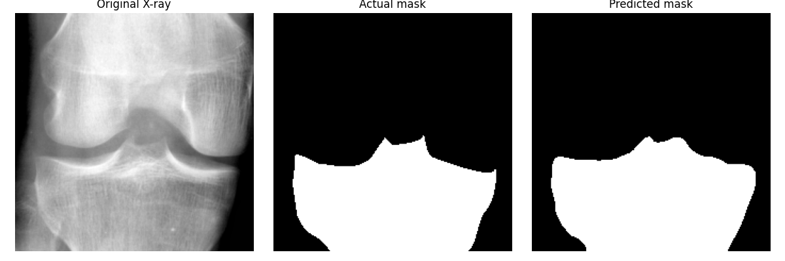
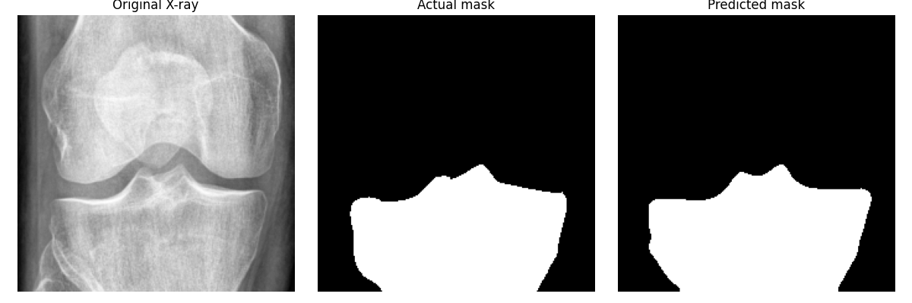

# Tibia X-ray Image Segmentation Using LeXT U-Net

A deep learning project for automatic tibia segmentation in X-ray images using a modified U-Net architecture implemented with PyTorch.

## Project Overview

This project was completed as part of the **Machine Vision and Neural Networks** course.

The objective was to develop a binary image segmentation model capable of identifying the tibia region in X-ray images.

The project uses a modified U-Net implementation developed by Aleksei Tiulpin from the University of Oulu. The model was trained using X-ray images and their corresponding annotated segmentation masks.

The work covers dataset preparation, image preprocessing, model implementation, training, validation, evaluation and prediction generation.

## Results at a Glance

| Evaluation | Result |
|---|---:|
| Model architecture | LeXT U-Net |
| Training images | 80 |
| Validation images | 20 |
| Test images | 50 |
| Best checkpoint epoch | 19 |
| Average validation Dice | **96.37%** |
| Prediction threshold | 0.5 |

**Note:** The Dice score represents the average result across the 20 annotated validation images. The 50 test images do not have ground-truth masks, so a quantitative test score could not be calculated.

## 1. Dataset and Preprocessing

The dataset contained:

- 150 X-ray images.
- 100 annotated segmentation masks.
- Images and processed masks resized to 224 × 224 pixels.

The dataset was divided into three groups:

| Dataset | Number of images |
|---|---:|
| Training | 80 |
| Validation | 20 |
| Testing | 50 |
| **Total X-ray images** | **150** |

The 100 annotated images were divided into 80 training images and 20 validation images. The remaining 50 images were reserved for testing.

Preprocessing included:

- Converting X-ray images to grayscale.
- Processing segmentation masks as binary masks.
- Resizing images and masks to 224 × 224 pixels.
- Normalizing image pixel values.
- Creating CSV files to organize the training, validation and test datasets.

**Dataset availability:** The original dataset is not included in this public repository. It must be obtained separately, subject to its original licence and usage conditions.

## 2. Model Architecture

This project uses a modified U-Net implementation developed by **Aleksei Tiulpin, University of Oulu (2017)**.

The architecture consists of:

- An encoder for extracting image features.
- A bottleneck for processing deeper features.
- A decoder for reconstructing segmentation maps.
- Skip connections that transfer information between encoder and decoder layers.

The model receives a single-channel grayscale X-ray image and produces a single-channel segmentation prediction.

### Model Configuration

| Parameter | Value |
|---|---|
| Basic width | 24 |
| Depth | 6 |
| Center depth | 2 |
| Input channels | 1 |
| Output channels | 1 |
| Convolution type | Regular |
| Activation function | ReLU |

The implementation is available in `models/unet_lext.py`.

## 3. Model Training

The model was trained using PyTorch with the following configuration:

| Parameter | Value |
|---|---|
| Architecture | LeXT U-Net |
| Epochs | 20 |
| Batch size | 4 |
| Learning rate | 0.0001 |
| Optimizer | Adam |
| Loss function | Combined BCE and Dice Loss |
| Random seed | 42 |
| Image size | 224 × 224 |

The training process combines Binary Cross-Entropy loss with Dice loss to support both pixel-level classification and segmentation overlap.

Random seeds were set for reproducibility. The best model checkpoint was selected based on validation Dice performance.

The best checkpoint was saved at **epoch 19**.

## 4. Model Evaluation

After training, the best saved checkpoint was evaluated using the 20 validation images.

### Validation Results

| Metric | Result |
|---|---:|
| Number of validation images | 20 |
| Average Dice score | 0.9637 |
| Average Dice percentage | **96.37%** |
| Prediction threshold | 0.5 |
| Best checkpoint epoch | 19 |

The Dice score was calculated separately for each validation image. The reported result is the average across all 20 images.

## 5. Segmentation Visualizations

The following examples compare the original X-ray image, the ground-truth segmentation mask and the prediction generated by the trained model.

### Example 1 – Validation Image 80



### Example 2 – Validation Image 83

This example demonstrates a close visual match between the ground-truth segmentation mask and the model prediction.



These examples illustrate the model's segmentation results on selected validation images. They are representative visual examples, not a guarantee of identical performance across every image.

### Generated Predictions

The evaluation script generated:

- **20 validation predictions** in `outputs/predictions/validation/`.
- **50 test predictions** in `outputs/predictions/test/`.
- **5 validation comparison figures** in `outputs/plots/`.

The 50 test predictions were generated without quantitative evaluation because corresponding annotated masks were unavailable.

## 6. Technologies and Libraries

The project was developed using:

- Python
- PyTorch
- NumPy
- Pandas
- Pillow (PIL)
- Matplotlib

## 7. Project Structure

```text
Image-Segmentation/
│
├── models/
│   ├── unet.py
│   └── unet_lext.py
│
├── data/
│   └── CSVs/
│       ├── train.csv
│       ├── validation.csv
│       └── test.csv
│
├── checkpoints/
│
├── outputs/
│   ├── plots/
│   └── predictions/
│       ├── validation/
│       └── test/
│
├── figures/
│   ├── tibia_segmentation_example.png
│   └── tibia_segmentation_example_2.png
│
├── train.py
├── evaluate.py
├── dataset.py
├── dice_score.py
├── process_masks.py
├── create_csv.py
├── split_csv.py
├── update_csv.py
├── check_masks.py
├── check_thresholds.py
├── create_chart.py
│
├── requirements.txt
├── LICENSE
├── .gitignore
└── README.md
```

The original dataset, trained model checkpoints and generated prediction images are excluded from the public repository. The two selected visualization figures are included in `figures/`.

## 8. How to Run the Project

### 1. Clone the repository

```bash
git clone https://github.com/puja0711/tibia-xray-image-segmentation.git
```

### 2. Open the project folder

```bash
cd tibia-xray-image-segmentation
```

### 3. Install the required libraries

```bash
pip install -r requirements.txt
```

### 4. Prepare the dataset

Obtain the dataset separately and prepare the image, mask and CSV folders according to the paths expected by the project.

The dataset must be prepared before training.

### 5. Train the model

```bash
python train.py
```

The best model checkpoint is saved as:

```text
checkpoints/best_model_lext.pth
```

### 6. Evaluate the model

```bash
python evaluate.py
```

The evaluation script loads the saved checkpoint, evaluates the validation images and generates predictions for the test images.

## 9. Project Limitations

Some limitations of this project include:

- The number of annotated training images was limited to 80.
- Predicted segmentation boundaries may not perfectly match the ground-truth masks.
- Model performance can vary between different X-ray images.
- The 50 test images do not have ground-truth masks, so quantitative test evaluation was not possible.
- Further experimentation with model architecture, training settings and preprocessing could provide additional improvements.

## 10. License and Attribution

This project uses a modified U-Net implementation developed by **Aleksei Tiulpin, University of Oulu (2017)**.

The original copyright notice is preserved in the model implementation.

The original MIT License is included in the repository in the `LICENSE` file.

## 11. Conclusion

In this project, I developed and trained a deep learning model for tibia X-ray image segmentation using PyTorch and a modified U-Net architecture.

The model achieved an average validation Dice score of **96.37% across 20 validation images** and generated segmentation predictions for 50 additional test images.

Through this assignment, I gained practical experience in image preprocessing, binary image segmentation, U-Net architectures, neural network training, model evaluation and visualization.

The project provided an opportunity to work with a real medical image segmentation task and understand the complete workflow of developing and evaluating a deep learning model.